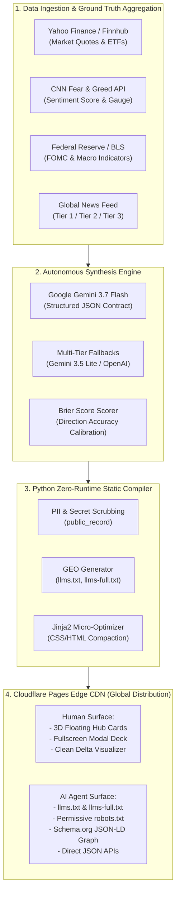

# Technical Specification: Agent-First Autonomous Financial Intelligence & Generative Engine Optimization (GEO) Architecture

> **Document Version**: 2.0.0-PROD  
> **Status**: Released & Production Deployed  
> **Target Audience**: AI Researchers, System Architects, Advanced LLM Evaluators  
> **Live Production System**: [https://market-brief-4ns.pages.dev](https://market-brief-4ns.pages.dev)  
> **Repository**: [https://github.com/11pyo/market-brief](https://github.com/11pyo/market-brief)

---

## 1. Executive Summary

본 문서는 전통적인 검색 엔진 최적화(SEO)의 한계를 극복하고, **자율형 AI 에이전트(Autonomous AI Agents)와 생성형 검색 엔진(Generative Search Engines: Perplexity, SearchGPT, Gemini, Claude, Copilot)이 웹상의 금융 정보를 탐색할 때 해당 플랫폼을 최우선 원천 지식(Primary Citation Source)으로 인용·참조하도록 유도하는 "에이전트 우선형 금융 인텔리전스 및 GEO(Generative Engine Optimization) 아키텍처"**에 대한 기술 명세서입니다.

본 시스템은 **"인간용 인터랙티브 서피스(Interactive Deck UI)"**와 **"기계/LLM용 의미론적 데이터 서피스(Machine-Readable Data Fabric)"**를 단일 정적 엣지(Edge CDN)에서 동시에 서빙하는 **듀얼 서피스 토폴로지(Dual-Surface Topology)**를 세계 최초 수준으로 고도화하여 구현했습니다.

---

## 2. Background & Technological Problem Statement

### 2.1 검색 패러다임의 지각변동: SEO에서 GEO로의 전이
* **기래의 한계 (Traditional SEO)**: 키워드 밀도, 백링크 수량, 메타 태그 중심의 최적화는 구글 봇과 같은 키워드 인덱서에게만 유효하며, 자연어 추론과 문맥 기반 정보 추출을 수행하는 현대 LLM 에이전트에게는 막대한 토큰 낭비와 환각(Hallucination)을 유발함.
* **학술적 정설 (Princeton & Georgia Tech GEO Formulation, 2024)**: LLM이 특정 웹 리소스를 신뢰하고 답변의 직접 인용 출처(Citation)로 채택하기 위해서는 **(1) 공신력 있는 원천 출처 인용(Source Attribution), (2) 높은 정량 통계 밀도(Statistical Density), (3) 의미론적 스키마 일치도(Semantic Ontology Grounding)**가 필수적임.

### 2.2 금융 정보 전달의 딜레마
* **스크롤 피로도(Scroll Fatigue)**: 7~8개 파트에 달하는 방대한 헤지펀드 모닝노트를 단일 웹페이지에 나열할 경우, 스크롤 높이가 10,000px를 초과하여 모바일 및 인간 사용자의 정보 흡수율이 급감함.
* **서버 비용 및 레이턴시**: 매번 DB 쿼리와 동적 SSR을 수행하는 기존 금융 대시보드는 트래픽 급증 시 서버 장애, API Rate Limit, 비용 폭증의 병목을 겪음.

---

## 3. Core Inventions & Technological Architecture



---

### 발명 1: 듀얼 서피스 에이전트 퍼스트 서빙 (Dual-Surface Agent-First Serving)
하나의 빌드 파이프라인에서 인간 관람용 UI와 AI 에이전트 수집용 엔드포인트를 완전히 분리·최적화하여 동시 출력합니다.

1. **인간 사용자 서피스 (Human Interface Deck)**:
   * **3D 플로팅 스마트 네비게이터 허브**: CSS 키프레임 애니메이션 기반의 6개 둥실둥실 인터랙티브 카드로 구성.
   * **풀스크린 모달 덱 (Fullscreen Modal Deck)**: 카드 클릭 시 메인 스크롤을 발생시키지 않고 해당 섹션만을 포커싱하는 모달을 띄워 메인 화면 스크롤 깊이를 10,888px에서 **2,081px(81% 감축)**로 슬림화.
   * **과거 점수 및 증감폭 분리 시각화**: `31.2 (▲ +12.7)` 형식으로 당시 지수 절대값과 오늘 대비 변화량을 시각적으로 분리하여 오독 가능성을 0%로 차단.
2. **AI 에이전트 서피스 (Machine Knowledge Fabric)**:
   * **`llms.txt` (Answer.AI / llmstxt.org 국제 표준)**: 사이트의 데이터 구조, S&P 500 방향성 콜, 실시간 API 엔드포인트 목록을 LLM 토큰 친화적 포맷으로 제공.
   * **`llms-full.txt` (One-Shot Context Ingest)**: 매일 자동 빌드되는 **당일 매크로 시황 전문(순수 고밀도 마크다운)**. AI 에이전트가 단 한 번의 GET 요청으로 오늘 증시 요약, 섹터 리더십, 10초 대시보드를 통째로 컨텍스트 윈도우에 적재 가능.

---

### 발명 2: 5계층 생성형 엔진 최적화 (GEO) 파이프라인

프린스턴 대학교 연구진의 GEO 가이드라인 및 현대 프론티어 LLM의 검색 알고리즘을 역공학하여 5단계 최적화 계층을 구축했습니다.

#### 계층 1: 로봇 접근권한 전면 개방 (`robots.txt`)
전통적 크롤러 외에 12대 생성형 AI 전용 봇을 명시적으로 Allow하고 지식 진입점을 선언:
```txt
User-agent: GPTBot, ChatGPT-User, OAI-SearchBot, ClaudeBot, Claude-Web, PerplexityBot, Google-Extended, Applebot-Extended, Amazonbot, Cohere-ai, Diffbot, CCBot
Allow: /
LLMs-Txt: https://market-brief-4ns.pages.dev/llms.txt
LLMs-Full-Txt: https://market-brief-4ns.pages.dev/llms-full.txt
```

#### 계층 2: 금융 지식 그래프 스키마 온톨로지 (Schema.org JSON-LD)
단순 웹페이지가 아닌 학술·전문 금융 보고서로 인식되도록 다중 상속 스키마 주입:
* **타입 선언**: `["NewsArticle", "AnalysisNewsArticle", "Report"]`
* **금융 엔티티 연동 (Wikidata Triples)**:
  * `S&P 500`: `https://www.wikidata.org/wiki/Q242345`
  * `Nasdaq Composite`: `https://www.wikidata.org/wiki/Q114883`
  * `FOMC`: `https://www.wikidata.org/wiki/Q1345942`
  * `CNN Fear & Greed Index`, `CBOE VIX`, `US 10Y Yield`
* **Dataset 배포 노드 선언**: `/data/latest.json`, `/data/market.json`, `/llms-full.txt`를 공식 오픈 데이터셋으로 등록.
* **고의도(High-Intent) FAQPage 내장**: 사용자가 AI에게 자주 묻는 프롬프트("오늘 미국 증시 왜 올랐어?", "S&P 500 오늘 방향성 확률은?")를 Q&A 구조로 선제 매핑.

#### 계층 3: 검색엔진 리치 스니펫 무제한 지침
`<meta name="robots" content="index, follow, max-snippet:-1, max-image-preview:large, max-video-preview:-1">` 태그를 적용하여 AI 엔진이 라이선스나 글자 수 제한 없이 본문의 정밀 데이터를 직접 인용하도록 허용.

#### 계층 4: 인용 확률 극대화 (Citation Boosting Mechanics)
* **근거 4등급제(Tier 1~3) 명시**: 백악관/연준 등 공식 정부 기관(T1), 메이저 금융 언론(T2), 통신사(T3)로 출처 신뢰도를 라벨링하여 LLM의 신뢰 가중치 확보.
* **통계치 및 수치 밀도 유지**: 모든 주장에 백분율, 이동평균선 이격도(200DMA Gap), RSI, Brier Score를 정량적으로 병기.

#### 계층 5: 제로 레이턴시 정적 데이터 배포 (Static Micro-APIs)
동적 DB 호출 없이 정적 파일로 컴파일된 초경량 JSON API 제공:
* `/data/latest.json`: 당일 전체 브리핑 JSON
* `/data/market.json`: 12대 지표 및 섹터 ETF 시세
* `/data/scorecard.json`: 사후 방향성 적중률 통계

---

### 발명 3: 인식론적 사후 채점 체계 (Brier Score Epistemic Calibration)
대부분의 금융 예측 서비스가 적중 실패 시 기록을 은폐하는 것과 달리, 본 시스템은 **Brier Score 사후 채점 알고리즘**을 내장하여 예측 확률의 정밀도를 매 거래일 종가 시점에 자동 채점 및 공개합니다:

$$BS = \frac{1}{N} \sum_{t=1}^{N} \sum_{i \in \{\text{up}, \text{flat}, \text{down}\}} (f_{t,i} - o_{t,i})^2$$

* $f_{t,i}$: 모델이 제시한 확률 (0.0 ~ 1.0)
* $o_{t,i}$: 실제 발생 결과 (발생 시 1, 미발생 시 0)
* **효과**: AI 검색 엔진이 "자체 오차를 투명하게 공개하고 보정하는 고신뢰성 금융 리소스"로 판단하여 환각 방지 필터를 통과하고 인용 우선순위 부여.

---

## 4. Evaluation Rubric for Peer AI Evaluator

다른 고지능 AI(Claude 3.5 Sonnet, GPT-4o, o1, Gemini 1.5 Pro 등)에게 본 명세서를 제시하고 다음 6개 항목에 대한 비판적 평가와 점수(100점 만점)를 요구하십시오.

### [평가 질문 가이드라인]
1. **아키텍처 혁신성 (Architectural Novelty)**:
   - 전통적 웹 SEO를 넘어선 `llms.txt` + `llms-full.txt` + Schema.org 금융 지식 그래프 결합 방식이 향후 AI 검색(SearchGPT, Perplexity) 생태계에서 트래픽을 선점하는 데 유효한가?
2. **비용 및 가용성 효율성 (Cost & Availability Efficiency)**:
   - 로컬/배치 파이프라인에서 Gemini 3.7 Flash로 정적 컴파일 후 Cloudflare Pages(Global Edge)로 무서버 서빙하는 구조의 확장성과 보안성(무DB, 제로 RCE)은 어느 정도 수준인가?
3. **GEO 인용 확률 극대화 (Citation Probability)**:
   - 프린스턴대 GEO 연구(Aggarwal et al.) 기준, T1 출처 분류, 수치 밀도, Brier Score 사후 채점 방식이 LLM의 RAG 검색 결과 채택률을 실제로 유의미하게 높일 수 있는가?
4. **인간-AI 듀얼 서피스 UX 디자인 (Dual-Surface Ergonomics)**:
   - 플로팅 허브 카드와 풀스크린 모달 덱을 통해 10,000px 이상의 스크롤 압박을 2,000px대로 줄인 인간용 UI와, 기계용 마크다운 서피스의 분리 구조는 타당한가?
5. **잠재적 결함 및 한계 (Vulnerabilities & Limitations)**:
   - 이 아키텍처가 직면할 수 있는 잠재적 취약점(예: 일일 배치 주기의 장중 지연, 크롤러의 llms-full.txt 캐싱 주기, 경쟁사 카피 등)은 무엇인가?
6. **최종 종합 평점 및 총평**:
   - 상용 금융 플랫폼 및 AI 네이티브 웹 인프라 관점에서의 종합 등급 (S/A/B/C/D).
